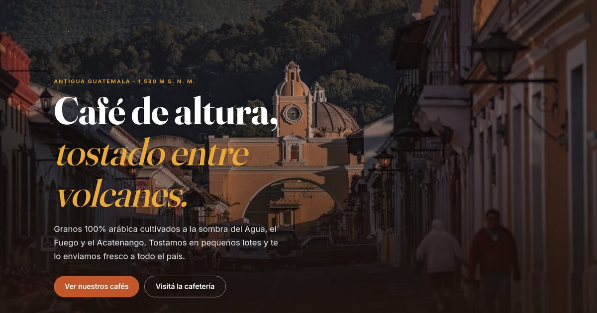

# Café Antigua — plantilla gratis de landing page

Landing page para una marca de café de especialidad de Antigua Guatemala. **Gratis y open source (MIT)**:
usala para tu cafetería, tostaduría o finca.

**Demo:** https://cafe.neuralcodelab.com

## Qué incluye

- Portada a pantalla completa, origen con cifras animadas, 3 cafés con notas de cata y precio,
  proceso de la finca a la taza, cafetería con horario, testimonios y llamado a pedir por **WhatsApp**.
- HTML, CSS y JavaScript puros: **sin frameworks ni build**. Abrí `index.html` y listo.
- Responsive con menú para celular, accesible (navegación con teclado, textos alternativos,
  respeta «reducir movimiento») y liviano (imágenes WebP).

## Personalizar

1. **Textos y precios:** `index.html`.
2. **Colores:** variables al inicio de `css/styles.css` (`--terracota`, `--espresso`, `--oro`…).
3. **WhatsApp:** cambiá `50200000000` por tu número en el enlace `wa.me` de `index.html`.
4. **Fotos:** reemplazá las de `assets/` por las tuyas (mismos nombres).

## Publicar

Es un sitio estático: subilo a Cloudflare, GitHub Pages, Netlify o cualquier hosting.
Este repo se publica con `npx wrangler deploy` (ver `wrangler.jsonc`).

---

Hecho por [NeuralCodeLab](https://neuralcodelab.com/plantillas-gratis) · Más plantillas gratis en neuralcodelab.com
